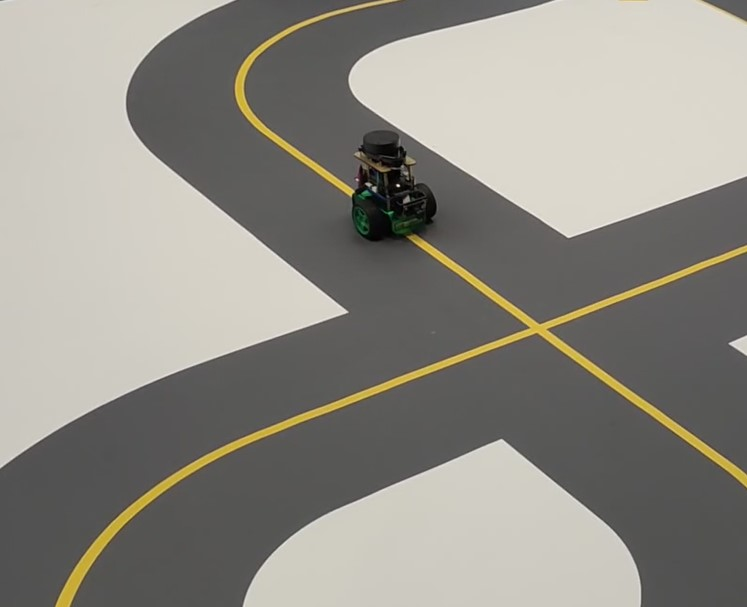
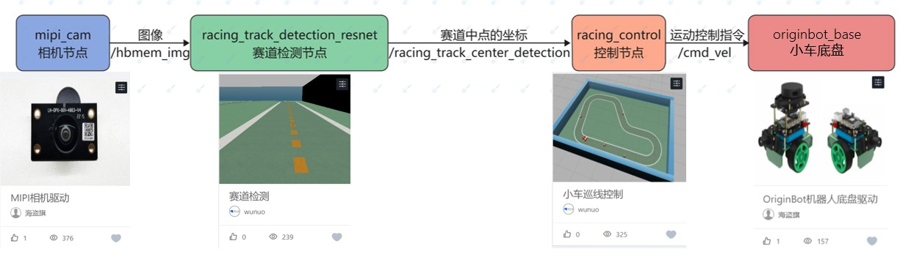

English| [简体中文](./README_cn.md)

# racing_line_follower

The Visual Line Tracking Demo implements the movement of the racing car within the track based on a purely visual method, with guiding lines in the middle of the track assisting the car to stay within the track.



To achieve the above function, three main modules are needed: visual input, environment perception, and motion control, including:

The visual input module is responsible for obtaining images of the real world (or simulated world) and passing them to the next-level environment perception module;

The environment perception module is responsible for perceiving the position of the racing car on the track and passing relevant information to the motion control module;

The motion control module calculates reasonable motion control commands based on the racing car's position information output by the environment perception module and sends them to the car for corresponding motion.


Next, it is necessary to refine and implement the above three major modules to complete the Visual Line Tracking Demo. [NodeHub](https://developer.horizon.cc/nodehub) is the "Intelligent Robot Application Center" provided by Horizon for robot developers, containing open-source Nodes with different functions that can be quickly installed and used. By connecting different Nodes, the implementation of the three major modules mentioned above can be completed.

# Implementation Details

## Visual Input

The "Peripheral Adaptation" section in [NodeHub](https://developer.horizon.cc/nodehub) includes various sensor and robot chassis adaptations, allowing easy acquisition of image and point cloud data. Here, select "[MIPI Camera Driver](https://developer.horizon.cc/nodehubdetail/168958376283445781)" to implement the visual input module. The main reason for selecting this module is that it supports the GC4663 wide-angle camera, which has a larger field of view, beneficial for the racing car in line tracking.

By checking the "MIPI Camera Driver" Node:

- This Node supports various common resolutions such as 1920x1080, 640x480;
- Topics published are /hbmem_image, /image_raw, /camera_info;
- Different resolutions can be selected through different launch files using ros2 launch.

Taking into account the accuracy and system load of the next-level perception module, the mipi_cam_640x480_nv12_hbmem.launch.py configuration file is chosen here, which publishes images with a resolution of 640x480 in NV12 format through shared memory.

Click on the "One-Click Deployment" button on the Node page to copy the generated command below to the RDK X3 terminal to run:

```shell
sudo apt update
sudo apt install -y tros-mipi-cam
```

After completing the "One-Click Deployment," the command to start this Node is:

```shell
source /opt/tros/setup.bash
ros2 launch mipi_cam mipi_cam_640x480_nv12_hbmem.launch.py
```

## Environmental Perception

Track detection, detecting the position relationship of guide lines in the track relative to the race car's body.In the "Competition Zone" section of [NodeHub](https://developer.horizon.cc/nodehub), [the “Track Detection” Node](https://developer.horizon.cc/nodehubdetail/184587678518566919) identifies the midpoint of the track in the image using a deep learning method and publishes it in the form of a topic.

By checking the "Track Detection" Node:

- The Node subscribes to the /hbmem_image topic, with the type hbm_img_msgs/msg/HbmMsg1080P. This topic is consistent with the topic published by the visual input module and allows access to the image data from the visual input module.

- The Node publishes the calculated processed track midpoint value to the /racing_track_center_detection topic, with the type geometry_msgs/msg/PointStamped.

- The default path for the model file is /opt/nodehub_model/race_detection/race_track_detection.bin, and the updated module can replace this file.

Click the "One-click Deployment" button on the Node page to copy the generated command below to run on the RDK X3 terminal:

```shell
sudo apt update
sudo apt install -y tros-racing-track-detection-resnet
```

After completing the "One-click Deployment", the command to start the Node is:

```shell
source /opt/tros/setup.bash
ros2 launch racing_track_detection_resnet racing_track_detection_resnet.launch.py
```

For model training methods, please refer to [the "Track Detection Model Training and Deployment Complete Explanation"](https://developer.horizon.cc/forumDetail/185446272545810434).

## Motion Control

In the "Competition Zone" section of [NodeHub](https://developer.horizon.cc/nodehub), [the “Car Line Following Control” Node](https://developer.horizon.cc/nodehubdetail/184587678518566923) receives messages from the track recognition node to control the car's line following.

By checking the "Car Line Following Control" Node:

- The Node subscribes to the /racing_track_center_detection topic, with the type geometry_msgs/msg/PointStamped. This topic is consistent with the one published by the "Track Detection" Node and is used to obtain track information for line following control.

- The Node processes perception information and publishes control information to the /cmd_vel topic, with the type geometry_msgs/msg/Twist.

Click the "One-click Deployment" button on the Node page to copy the generated command below to run on the RDK X3 terminal:

```shell
sudo apt update
sudo apt install -y tros-racing-control
```

After completing the "One-click Deployment", the command to start the Node is:

```shell
source /opt/tros/local_setup.bash
ros2 launch racing_control racing_control.launch.py avoid_angular_ratio:=0.2 avoid_linear_speed:=0.1 follow_angular_ratio:=-1.0 follow_linear_speed:=0.1
```

## Start the Chassis

The "Peripheral Adaptation" section of [NodeHub](https://developer.horizon.cc/nodehub) includes various robot chassis options, to be selected based on the robot model. Here, taking [the "Originbot Chassis Driver"](https://developer.horizon.cc/nodehubdetail/170117036053371431) as an example, this node receives messages from the control node, decomposes them into controls for each motor, and achieves the movement of the car.Viewing the "Originbot Chassis Drive" Node:

This Node subscribes to the /cmd_vel topic with the type geometry_msgs/msg/Twist. This topic is consistent with the topic published by the "Car Line Following Control" Node, used to obtain control information for motor control.

Click the "One-click Deployment" button on the Node page, and copy the generated command below to run in the RDK X3 terminal:
```shell
sudo apt update
sudo apt install -y tros-originbot-base tros-serial tros-originbot-msgs
```

After completing the "One-click Deployment," the command to start the Node is:
```shell
source /opt/tros/setup.bash
ros2 launch originbot_base robot.launch.py
```

At this point, the visual line following demo has been set up as shown in the overall detailed diagram below.
